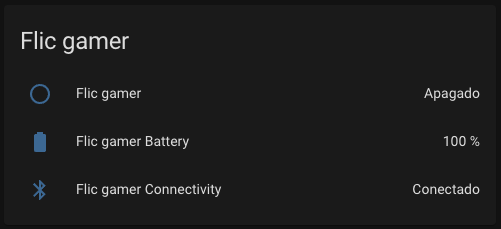

# Automations and dashboards

## The `flic_click` event { #flic-click }

Every click the module accepts fires a `flic_click` event in Home Assistant, with this data:

| Field | Example | Meaning |
|---|---|---|
| `button_name` | `flic_80e4da779fc7` | `flic_` followed by the button's Bluetooth address without colons |
| `button_address` | `80:e4:da:77:9f:c7` | The button's Bluetooth address |
| `click_type` | `single`, `double`, or `hold` | The gesture |

`button_name` always uses the `flic_<address>` format without colons (e.g. `flic_80e4da779fc7`), matching the button entity ID. It does not change if you rename the button in the Flic app.

The hub determines the gesture timing:

- `single` arrives ~0.5 s after release, once the double-click timeout expires.
- `double` arrives immediately after the second release.
- `hold` arrives after holding for 1 second, while the button is still pressed.

The module filters out duplicate and phantom clicks, ensuring each physical press fires at most one event (see [How the module behaves](behavior.md#one-event-per-press)).

## Automations

### One click type { #single-click }

```yaml
automation:
  - alias: "Turn on lights in the living room on single flic click"
    triggers:
      - trigger: event
        event_type: flic_click
        event_data:
          button_name: flic_80e4da779fc7
          click_type: single
    actions:
      - action: homeassistant.turn_on
        target:
          entity_id: group.lights_living_room
```

### All three click types { #all-click-types }

One automation can handle every gesture of a button:

```yaml
automation:
  - alias: "Living room Flic"
    triggers:
      - trigger: event
        event_type: flic_click
        event_data:
          button_name: flic_80e4da779fc7
    actions:
      - choose:
          - conditions: "{{ trigger.event.data.click_type == 'single' }}"
            sequence:
              - action: light.toggle
                target:
                  entity_id: light.living_room
          - conditions: "{{ trigger.event.data.click_type == 'double' }}"
            sequence:
              - action: scene.turn_on
                target:
                  entity_id: scene.movie_night
          - conditions: "{{ trigger.event.data.click_type == 'hold' }}"
            sequence:
              - action: light.turn_off
                target:
                  entity_id: all
```

The [blueprint](#blueprint) does the same, with a form for each action.

### By Bluetooth address { #by-address }

Match on `button_address` instead of `button_name` if you prefer. Quote the address:

```yaml
    triggers:
      - trigger: event
        event_type: flic_click
        event_data:
          button_address: "80:e4:da:77:9f:c7"
          click_type: double
```

### While the button is held { #while-held }

Because the button's binary sensor remains `on` while held, a `hold` event can repeat an action until release. This example steps down brightness while held:

```yaml
automation:
  - alias: "Dim the living room while the Flic is held"
    triggers:
      - trigger: event
        event_type: flic_click
        event_data:
          button_name: flic_80e4da779fc7
          click_type: hold
    actions:
      - repeat:
          while:
            - condition: state
              entity_id: binary_sensor.flic_80e4da779fc7
              state: "on"
          sequence:
            - action: light.turn_on
              target:
                entity_id: light.living_room
              data:
                brightness_step_pct: -10
            - delay:
                milliseconds: 300
```

## Blueprint { #blueprint }

The repository includes a blueprint that runs a different action for each click type of one button. It needs Home Assistant 2024.10 or newer.

[](https://my.home-assistant.io/redirect/blueprint_import/?blueprint_url=https%3A%2F%2Fgithub.com%2Fblunan%2Fha-flichub-module%2Fblob%2Fmain%2Fflic-button.yaml)

When you create an automation from it, fill in:

- **Flic Button Name:** the button's `button_name`, such as `flic_80e4da779fc7`.
- **Single Click Action**, **Double Click Action**, and **Hold Action:** what each gesture does. Leave any of them empty to ignore that gesture.

The automation runs in `single` mode, ignoring new clicks while an action is executing.

??? example "The blueprint (`flic-button.yaml`)"

    ```yaml
    --8<-- "flic-button.yaml"
    ```

## Test without pressing a button { #test-an-automation }

In Home Assistant, go to **Developer tools → Events**:

- To see real clicks, enter `flic_click` under **Listen to events**, select **Start listening**, and click the button.
- To try an automation without the button, fire a `flic_click` event with data like this:

    ```yaml
    button_name: flic_80e4da779fc7
    button_address: "80:e4:da:77:9f:c7"
    click_type: double
    ```

## Dashboard card { #dashboard }

An entities card shows the state, battery, and connectivity of a button:



```yaml
type: entities
title: Flic gamer
entities:
  - entity: binary_sensor.flic_80e4da779fc7
  - entity: sensor.flic_80e4da779fc7_battery
  - entity: binary_sensor.flic_80e4da779fc7_connectivity
```

Because the entities [can't be renamed from the UI](entities.md#no-unique-id), set a `name` or `icon` on a row to change how the card shows it:

```yaml
  - entity: binary_sensor.flic_80e4da779fc7
    name: Pressed
```

## Coming from the flicd add-on { #coming-from-flicd }

Automations written for [pschmitt's flicd add-on](https://github.com/pschmitt/home-assistant-addons) remain compatible. The module emits identical [event types and payload data](https://www.home-assistant.io/integrations/flic): `flic_click` with `button_name`, `button_address`, and `click_type`.

Only `queued_time` isn't sent. Automations that use it need a different approach.
