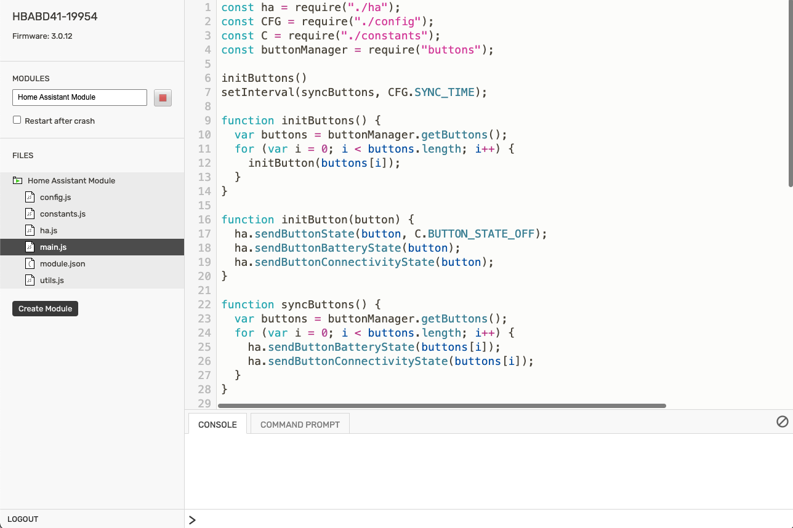

# Installation

The module runs on your Flic Hub. To install it, create a module in the hub's Online IDE and paste in the files from the [`flic_hub_module`](https://github.com/blunan/ha-flichub-module/tree/main/flic_hub_module) folder of this repository.

## Before you start

- **Pair your buttons** with the Flic Hub. The module picks up every button the hub knows about, including ones you pair later.
- **Create a Long-Lived Access Token** in Home Assistant: open your [profile](https://www.home-assistant.io/docs/authentication/#your-account-profile), go to the **Security** tab, and select **Create token** under **Long-lived access tokens**. Copy it immediately; Home Assistant displays it only once. The token must belong to an administrator to set states and fire events via the API.
- **Check the API integration:** The module requires the [Home Assistant REST API](https://developers.home-assistant.io/docs/api/rest), provided by the [API integration](https://www.home-assistant.io/integrations/api) (enabled by default). If you removed `default_config:`, add `api:` to `configuration.yaml`.
- **Note the address** the hub should use to reach Home Assistant, such as `https://192.168.1.20:8123`. If Home Assistant uses a self-signed certificate, read [HTTPS and certificates](https.md) as well.

## Create the module

1. Open the [Flic Hub Online IDE](https://hubsdk.flic.io) and sign in to your hub.
2. Select **Create Module** and give it a name, such as *Home Assistant Module*.
3. Create one file for each file in the [`flic_hub_module`](https://github.com/blunan/ha-flichub-module/tree/main/flic_hub_module) folder, with the same name, and paste in its contents:
    - `config.js`
    - `constants.js`
    - `ha.js`
    - `logger.js`
    - `main.js`
    - `module.json`
    - `utils.js`

    If the IDE already created a `main.js` or `module.json` for you, replace their contents.

4. Edit `config.js`. Set `SERVER_HOST` to your Home Assistant address (e.g. `http://192.168.1.20:8123`) and `SERVER_AUTH_TOKEN` to your token. See [Configuration](configuration.md) for optional settings like HTTPS certificates or logging verbosity.
5. Start the module with the play button next to its name. Tick **Restart after crash** so the hub restarts the module if it ever crashes.

It should look something like this:

## Check that it works { #check }

1. In Home Assistant, go to **Developer tools → States** and search for `flic_`. Each button creates three entities:
    - `binary_sensor.flic_<address>`: physical press state (`on` while pressed, `off` released).
    - `sensor.flic_<address>_battery`: battery percentage (`0`–`100`%).
    - `binary_sensor.flic_<address>_connectivity`: hub connection status (`on` / `off`).
2. Press and hold a button: its `binary_sensor.flic_<address>` entity turns `on` while you hold it and `off` when you let go.
3. To verify click events, go to **Developer tools → Events**, start listening to `flic_click`, and click the button. Events arrive with `button_name`, `button_address`, and `click_type` (`single`, `double`, or `hold`). See [Entities](entities.md) for details on attributes and icons.

With `LOG_LEVEL` at its default, `C.LOG_LEVEL_WARNING`, the **Console** at the bottom of the IDE stays quiet unless something needs your attention. If nothing shows up in Home Assistant, see [Troubleshooting](troubleshooting.md).

## Update the module { #update }

1. Stop the module in the IDE.
2. Replace all files except `config.js` with the updated versions, and add any newly introduced files.
3. Compare `config.js` with the updated version; copy your settings over if options were added or renamed.
4. Start the module again.

The [releases page](https://github.com/blunan/ha-flichub-module/releases) lists what changed in each version.

## Remove the module

Stop and delete the module in the IDE. Entities remain in Home Assistant until its next restart, as REST-managed states do not persist. To remove a button's entities immediately, unpair it from the hub instead (see [Removing a button](behavior.md#removing-a-button)).
